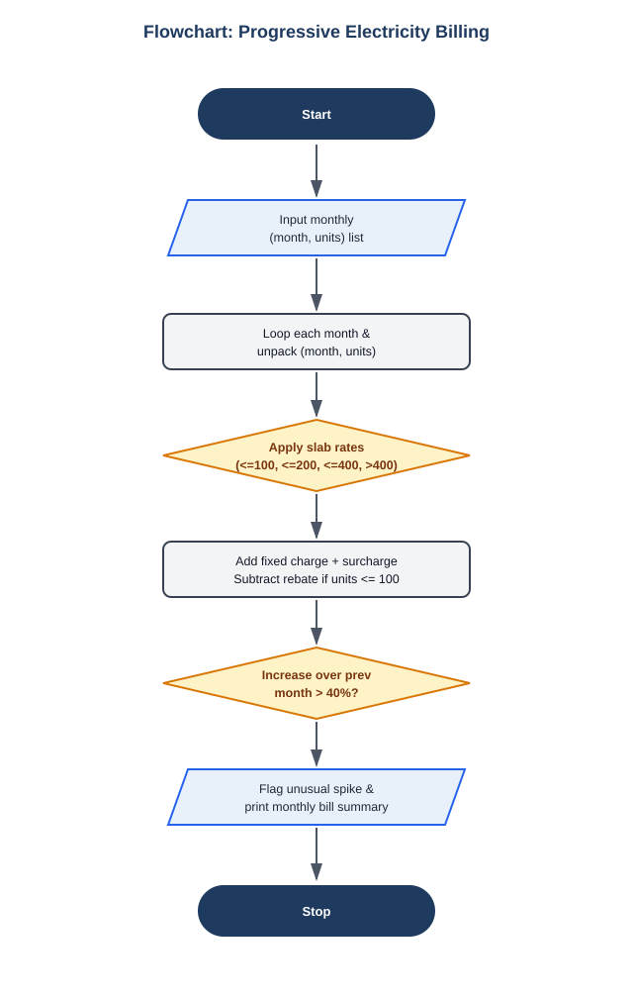
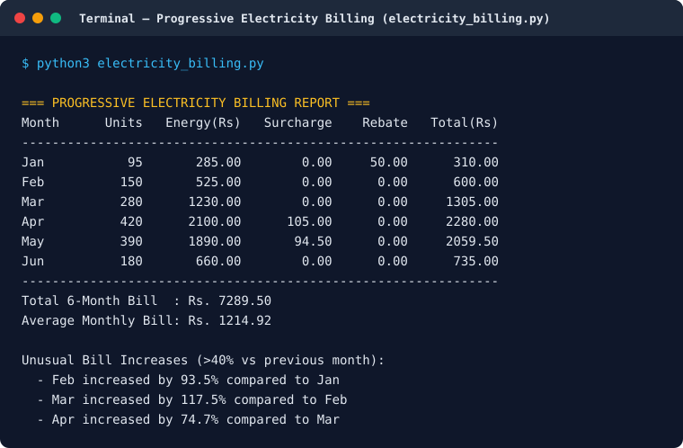

# Case Study 2 — Progressive Electricity Billing

> **Syllabus used:** variables · data types · operators · conditional statements · loops · lists · tuples · unpacking

## Deliverables Index

| # | Deliverable | Where to find it |
| :---: | :--- | :--- |
| 1 | Problem statement | [Section 1](#1-problem-statement) |
| 2 | Objectives | [Section 2](#2-objectives) |
| 3 | Assumptions | [Section 3](#3-assumptions) |
| 4 | Algorithm | [Section 4](#4-algorithm) |
| 5 | Flowchart | [Section 5](#5-flowchart) · [`flowchart.svg`](flowchart.svg) |
| 6 | Pseudocode | [Section 6](#6-pseudocode) |
| 7 | Python source code | [Section 7](#7-python-source-code) · [`electricity_billing.py`](electricity_billing.py) |
| 8 | Test cases | [Section 8](#8-test-cases) |
| 9 | Output screenshots | [Section 9](#9-output-screenshots) · [`outputs/output_screenshot.svg`](outputs/output_screenshot.svg) |
| 10 | Conclusion | [Section 10](#10-conclusion) |

---

## 1. Problem Statement
Calculate monthly household electricity bills using progressive consumption slabs, fixed meter charges, fuel surcharges, and prompt-payment rebates. Compare bills across multiple months and flag any unusual spikes in usage.

## 2. Objectives
- Compute energy charges accurately across tiered unit slabs using conditional logic.
- Apply fixed charges, percentage surcharges, and eligible low-usage rebates.
- Track multi-month bills in a list and detect unusual month-over-month increases.

## 3. Assumptions
- Slabs: 0-100 units @ Rs. 3.00/unit, 101-200 units @ Rs. 4.50/unit, 201-400 units @ Rs. 6.00/unit, above 400 units @ Rs. 7.50/unit.
- Fixed charge is Rs. 75.00 per month; surcharge is 5% on energy charge when units > 300.
- Rebate of Rs. 50.00 applies when monthly consumption is <= 100 units.
- An increase > 40% compared to the previous month is flagged as an unusual increase.

## 4. Algorithm
1. Start and initialize the list of monthly meter readings as (month, units) tuples.
2. For each month, unpack the month name and units consumed.
3. Compute energy charge using if-elif-else slab conditions.
4. Add fixed charge (75) and 5% surcharge if units > 300; subtract Rs. 50 rebate if units <= 100.
5. Store the calculated bill in a bills list and compare with the previous month's bill.
6. If the percentage increase over the previous month exceeds 40%, flag the month as an unusual spike.
7. Display the monthly bill table, total, average, and any flagged months, then stop.

## 5. Flowchart


## 6. Pseudocode
```text
BEGIN
  SET readings = [("Jan", 95), ("Feb", 150), ("Mar", 280), ("Apr", 420), ("May", 390), ("Jun", 180)]
  SET bills = []
  FOR EACH (month, units) IN readings:
    COMPUTE energy_charge from slabs
    surcharge = 0.05 * energy_charge IF units > 300 ELSE 0
    rebate = 50.0 IF units <= 100 ELSE 0
    total_bill = energy_charge + 75.0 + surcharge - rebate
    APPEND (month, units, total_bill) TO bills
  END FOR
  COMPARE consecutive bills; FLAG if growth > 40%
  PRINT summary report
END
```

## 7. Python Source Code
File: [`electricity_billing.py`](electricity_billing.py)

```python
# Case Study 2: Progressive Electricity Billing
# Syllabus: Variables, Operators, Conditionals, Loops, Lists, Tuples, Unpacking

monthly_readings = [
    ("Jan", 95),
    ("Feb", 150),
    ("Mar", 280),
    ("Apr", 420),
    ("May", 390),
    ("Jun", 180)
]

fixed_charge = 75.0
bill_records = []
unusual_months = []

print("=== PROGRESSIVE ELECTRICITY BILLING REPORT ===")
print(f"{'Month':<8}{'Units':>8}{'Energy(Rs)':>13}{'Surcharge':>12}{'Rebate':>10}{'Total(Rs)':>12}")
print("-" * 63)

for month, units in monthly_readings:
    if units <= 100:
        energy_charge = units * 3.0
    elif units <= 200:
        energy_charge = (100 * 3.0) + (units - 100) * 4.5
    elif units <= 400:
        energy_charge = (100 * 3.0) + (100 * 4.5) + (units - 200) * 6.0
    else:
        energy_charge = (100 * 3.0) + (100 * 4.5) + (200 * 6.0) + (units - 400) * 7.5

    surcharge = 0.05 * energy_charge if units > 300 else 0.0
    rebate = 50.0 if units <= 100 else 0.0
    total_bill = energy_charge + fixed_charge + surcharge - rebate

    bill_records.append((month, units, total_bill))
    print(f"{month:<8}{units:>8}{energy_charge:>13.2f}{surcharge:>12.2f}{rebate:>10.2f}{total_bill:>12.2f}")

total_amount = 0.0
for i in range(len(bill_records)):
    month, units, bill = bill_records[i]
    total_amount += bill
    if i > 0:
        prev_month, prev_units, prev_bill = bill_records[i - 1]
        pct_change = ((bill - prev_bill) / prev_bill) * 100.0
        if pct_change > 40.0:
            unusual_months.append((month, prev_month, pct_change))

avg_bill = total_amount / len(bill_records)
print("-" * 63)
print(f"Total 6-Month Bill  : Rs. {total_amount:.2f}")
print(f"Average Monthly Bill: Rs. {avg_bill:.2f}")

if len(unusual_months) > 0:
    print("\nUnusual Bill Increases (>40% vs previous month):")
    for cur_m, prev_m, pct in unusual_months:
        print(f"  - {cur_m} increased by {pct:.1f}% compared to {prev_m}")
else:
    print("\nNo unusual bill increases detected.")
```

## 8. Test Cases
| Test ID | Input Scenario | Expected Outcome | Status |
| :--- | :--- | :--- | :--- |
| TC-01 | Jan: 95 units (Slab 1 + Rebate) | Energy=285.00, Fixed=75, Rebate=50, Total=310.00 | Pass |
| TC-02 | Feb: 150 units (Slab 2) | Total=600.00, +93.5% spike vs Jan flagged | Pass |
| TC-03 | Apr: 420 units (Slab 4 + 5% Surcharge) | Energy=2100.00, Surcharge=105.00, Total=2280.00 | Pass |
| TC-04 | Jun: 180 units (Drop from May) | Total=735.00, not flagged as spike | Pass |

## 9. Output Screenshots


## 10. Conclusion
The progressive electricity billing program accurately computes tiered slab charges, fixed fees, surcharges, and rebates using conditional statements and loops, while identifying abnormal month-to-month bill spikes from stored bill records.
