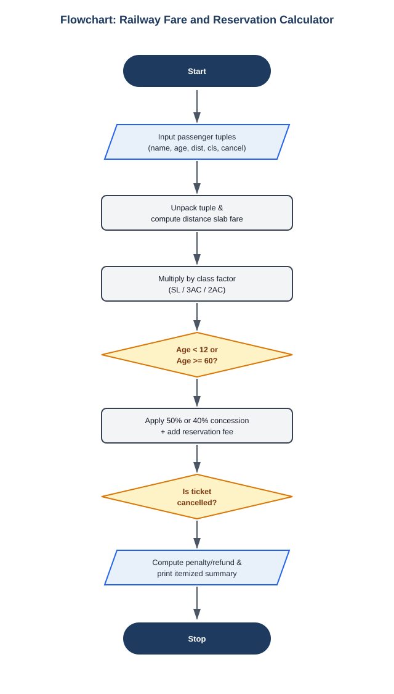
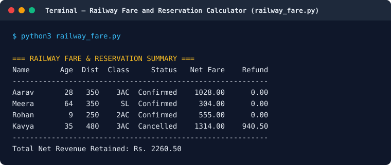

# Case Study 6 — Railway Fare and Reservation Calculator

> **Syllabus used:** variables · data types · operators · conditional statements · loops · lists · tuples · unpacking

## Deliverables Index

| # | Deliverable | Where to find it |
| :---: | :--- | :--- |
| 1 | Problem statement | [Section 1](#1-problem-statement) |
| 2 | Objectives | [Section 2](#2-objectives) |
| 3 | Assumptions | [Section 3](#3-assumptions) |
| 4 | Algorithm | [Section 4](#4-algorithm) |
| 5 | Flowchart | [Section 5](#5-flowchart) · [`flowchart.svg`](flowchart.svg) |
| 6 | Pseudocode | [Section 6](#6-pseudocode) |
| 7 | Python source code | [Section 7](#7-python-source-code) · [`railway_fare.py`](railway_fare.py) |
| 8 | Test cases | [Section 8](#8-test-cases) |
| 9 | Output screenshots | [Section 9](#9-output-screenshots) · [`outputs/output_screenshot.svg`](outputs/output_screenshot.svg) |
| 10 | Conclusion | [Section 10](#10-conclusion) |

---

## 1. Problem Statement
Calculate railway ticket fares for multiple passengers based on distance slabs, travel class (Sleeper, 3AC, 2AC), age-based concessions (child and senior citizen), reservation fees, and cancellation penalties when a booking is cancelled.

## 2. Objectives
- Compute base fare using progressive distance slabs and travel class multipliers.
- Apply age-based concessions using conditional statements and tuple unpacking.
- Calculate final payable fare or refund after applying cancellation penalties.

## 3. Assumptions
- Distance slabs: first 100 km @ Rs. 1.50/km, next 200 km @ Rs. 1.20/km, beyond 300 km @ Rs. 1.00/km.
- Class multipliers: SL = 1.0x, 3AC = 2.2x, 2AC = 3.0x; reservation fee = Rs. 40 (SL) or Rs. 60 (AC).
- Concessions: Age < 12 gets 50% off base fare; Age >= 60 gets 40% off base fare.
- Cancellation penalty is 25% of net fare plus non-refundable reservation fee.

## 4. Algorithm
1. Start and store passenger booking records as a list of tuples (name, age, distance, class, cancelled_flag).
2. For each passenger tuple, unpack all five attributes.
3. Compute base distance fare using progressive distance slabs.
4. Multiply by the travel class factor (SL, 3AC, or 2AC) and apply age concession.
5. Add the class-specific reservation fee to obtain total ticket fare.
6. If cancelled_flag is True, compute 25% penalty + forfeited reservation fee and calculate refund.
7. Display the itemized passenger fare and refund summary, then stop.

## 5. Flowchart


## 6. Pseudocode
```text
BEGIN
  SET passengers = [("Aarav", 28, 350, "3AC", False), ("Meera", 64, 350, "SL", False), ...]
  FOR EACH (name, age, dist, cls, is_cancelled) IN passengers:
    COMPUTE base_dist_fare from distance slabs
    SET multiplier = 1.0 (SL), 2.2 (3AC), or 3.0 (2AC)
    APPLY concession (50% if age < 12, 40% if age >= 60)
    ADD reservation_fee (40 for SL, 60 for AC)
    IF is_cancelled: COMPUTE penalty and refund
    PRINT passenger summary
  END FOR
END
```

## 7. Python Source Code
File: [`railway_fare.py`](railway_fare.py)

```python
# Case Study 6: Railway Fare and Reservation Calculator
# Syllabus: Variables, Conditionals, Loops, Lists, Tuples, Unpacking

passengers = [
    ("Aarav", 28, 350, "3AC", False),
    ("Meera", 64, 350, "SL", False),
    ("Rohan", 9, 250, "2AC", False),
    ("Kavya", 35, 480, "3AC", True)
]

total_collected = 0.0

print("=== RAILWAY FARE & RESERVATION SUMMARY ===")
print(f"{'Name':<10}{'Age':>4}{'Dist':>6}{'Class':>7}{'Status':>11}{'Net Fare':>11}{'Refund':>10}")
print("-" * 59)

for name, age, dist, travel_class, is_cancelled in passengers:
    if dist <= 100:
        dist_fare = dist * 1.5
    elif dist <= 300:
        dist_fare = (100 * 1.5) + (dist - 100) * 1.2
    else:
        dist_fare = (100 * 1.5) + (200 * 1.2) + (dist - 300) * 1.0

    if travel_class == "SL":
        multiplier = 1.0
        res_fee = 40.0
    elif travel_class == "3AC":
        multiplier = 2.2
        res_fee = 60.0
    else:
        multiplier = 3.0
        res_fee = 60.0

    class_fare = dist_fare * multiplier

    if age < 12:
        concession = 0.50 * class_fare
    elif age >= 60:
        concession = 0.40 * class_fare
    else:
        concession = 0.0

    net_ticket = (class_fare - concession) + res_fee

    if is_cancelled:
        penalty = 0.25 * (class_fare - concession) + res_fee
        refund = net_ticket - penalty
        retained = penalty
        status = "Cancelled"
    else:
        refund = 0.0
        retained = net_ticket
        status = "Confirmed"

    total_collected += retained
    print(f"{name:<10}{age:>4}{dist:>6}{travel_class:>7}{status:>11}{net_ticket:>11.2f}{refund:>10.2f}")

print("-" * 59)
print(f"Total Net Revenue Retained: Rs. {total_collected:.2f}")
```

## 8. Test Cases
| Test ID | Input Scenario | Expected Outcome | Status |
| :--- | :--- | :--- | :--- |
| TC-01 | Aarav, 28, 350 km, 3AC, Confirmed | Full fare with Rs. 60 reservation = Rs. 1028.00 | Pass |
| TC-02 | Meera, 64, 350 km, SL, Confirmed | 40% senior concession + Rs. 40 res = Rs. 304.00 | Pass |
| TC-03 | Rohan, 9, 250 km, 2AC, Confirmed | 50% child concession + Rs. 60 res = Rs. 555.00 | Pass |
| TC-04 | Kavya, 35, 480 km, 3AC, Cancelled | 25% penalty + res fee retained; Refund = Rs. 940.50 | Pass |

## 9. Output Screenshots


## 10. Conclusion
Using tuples and tuple unpacking, the railway calculator cleanly handles multi-passenger bookings across distance slabs, class multipliers, age concessions, and cancellation refunds.
