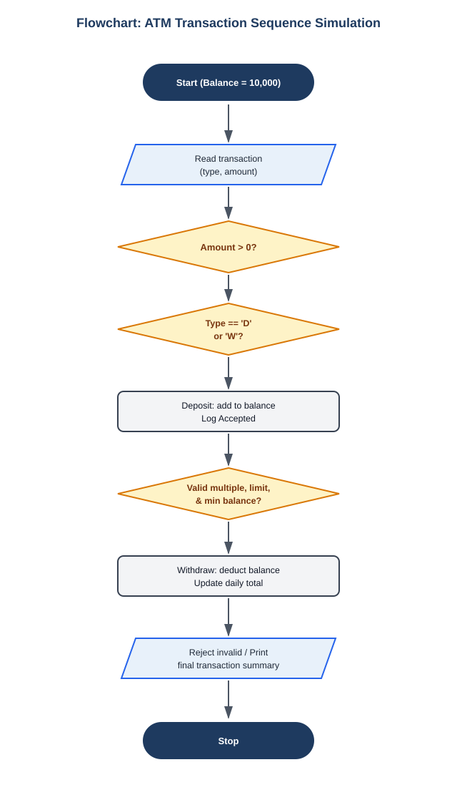
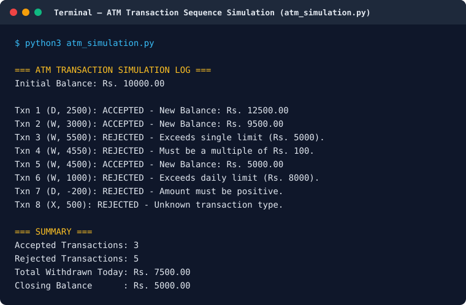

# Case Study 13 — ATM Transaction Sequence Simulation

> **Syllabus used:** variables · data types · operators · conditional statements · loops · lists · tuples · unpacking

## Deliverables Index

| # | Deliverable | Where to find it |
| :---: | :--- | :--- |
| 1 | Problem statement | [Section 1](#1-problem-statement) |
| 2 | Objectives | [Section 2](#2-objectives) |
| 3 | Assumptions | [Section 3](#3-assumptions) |
| 4 | Algorithm | [Section 4](#4-algorithm) |
| 5 | Flowchart | [Section 5](#5-flowchart) · [`flowchart.svg`](flowchart.svg) |
| 6 | Pseudocode | [Section 6](#6-pseudocode) |
| 7 | Python source code | [Section 7](#7-python-source-code) · [`atm_simulation.py`](atm_simulation.py) |
| 8 | Test cases | [Section 8](#8-test-cases) |
| 9 | Output screenshots | [Section 9](#9-output-screenshots) · [`outputs/output_screenshot.svg`](outputs/output_screenshot.svg) |
| 10 | Conclusion | [Section 10](#10-conclusion) |

---

## 1. Problem Statement
Simulate an ATM account processing a sequence of deposit and withdrawal requests. Maintain the running balance, enforce per-transaction and daily withdrawal limits, reject invalid operations, and generate a complete transaction summary.

## 2. Objectives
- Process sequential deposit ('D') and withdrawal ('W') tuples using a loop.
- Enforce minimum balance, negative-amount rejection, and daily withdrawal limits.
- Record accepted and rejected transactions and print a final balance summary.

## 3. Assumptions
- Initial account balance is Rs. 10,000.00; minimum required balance is Rs. 500.00.
- Maximum single withdrawal is Rs. 5,000.00 and daily withdrawal limit is Rs. 8,000.00.
- Withdrawal amounts must be positive multiples of Rs. 100.

## 4. Algorithm
1. Start with initial balance = 10000, daily_withdrawn = 0, and a list of transaction tuples.
2. Initialize counters for accepted and rejected transactions.
3. Loop through each (txn_type, amount) tuple in the transaction sequence.
4. If amount <= 0, reject as invalid amount.
5. If txn_type == 'D', add amount to balance and log as Accepted.
6. If txn_type == 'W', verify amount % 100 == 0, amount <= 5000, daily_withdrawn + amount <= 8000, and balance - amount >= 500; otherwise reject with reason.
7. Print transaction log and final account summary, then stop.

## 5. Flowchart


## 6. Pseudocode
```text
BEGIN
  SET balance = 10000.0, min_bal = 500.0, daily_withdrawn = 0.0
  FOR EACH (t_type, amt) IN transactions:
    IF amt <= 0: REJECT "Non-positive amount"
    ELSE IF t_type == "D": balance += amt; ACCEPT
    ELSE IF t_type == "W":
      CHECK multiple of 100, single <= 5000, daily <= 8000, balance - amt >= 500
      IF valid: balance -= amt; daily_withdrawn += amt; ACCEPT
      ELSE: REJECT with reason
    END IF
  END FOR
  PRINT summary
END
```

## 7. Python Source Code
File: [`atm_simulation.py`](atm_simulation.py)

```python
# Case Study 13: ATM Transaction Sequence Simulation
# Syllabus: Variables, Conditionals, Loops, Lists, Tuples, Unpacking

balance = 10000.0
min_balance = 500.0
single_limit = 5000.0
daily_limit = 8000.0
daily_withdrawn = 0.0

transactions = [
    ("D", 2500),
    ("W", 3000),
    ("W", 5500),
    ("W", 4550),
    ("W", 4500),
    ("W", 1000),
    ("D", -200),
    ("X", 500)
]

accepted_count = 0
rejected_count = 0

print("=== ATM TRANSACTION SIMULATION LOG ===")
print(f"Initial Balance: Rs. {balance:.2f}\n")

for idx in range(len(transactions)):
    t_type, amount = transactions[idx]
    step = idx + 1

    if amount <= 0:
        rejected_count += 1
        print(f"Txn {step} ({t_type}, {amount}): REJECTED - Amount must be positive.")
    elif t_type == "D":
        balance += amount
        accepted_count += 1
        print(f"Txn {step} (D, {amount}): ACCEPTED - New Balance: Rs. {balance:.2f}")
    elif t_type == "W":
        if amount % 100 != 0:
            rejected_count += 1
            print(f"Txn {step} (W, {amount}): REJECTED - Must be a multiple of Rs. 100.")
        elif amount > single_limit:
            rejected_count += 1
            print(f"Txn {step} (W, {amount}): REJECTED - Exceeds single limit (Rs. {single_limit:.0f}).")
        elif daily_withdrawn + amount > daily_limit:
            rejected_count += 1
            print(f"Txn {step} (W, {amount}): REJECTED - Exceeds daily limit (Rs. {daily_limit:.0f}).")
        elif balance - amount < min_balance:
            rejected_count += 1
            print(f"Txn {step} (W, {amount}): REJECTED - Minimum balance Rs. {min_balance:.0f} required.")
        else:
            balance -= amount
            daily_withdrawn += amount
            accepted_count += 1
            print(f"Txn {step} (W, {amount}): ACCEPTED - New Balance: Rs. {balance:.2f}")
    else:
        rejected_count += 1
        print(f"Txn {step} ({t_type}, {amount}): REJECTED - Unknown transaction type.")

print("\n=== SUMMARY ===")
print(f"Accepted Transactions: {accepted_count}")
print(f"Rejected Transactions: {rejected_count}")
print(f"Total Withdrawn Today: Rs. {daily_withdrawn:.2f}")
print(f"Closing Balance      : Rs. {balance:.2f}")
```

## 8. Test Cases
| Test ID | Input Scenario | Expected Outcome | Status |
| :--- | :--- | :--- | :--- |
| TC-01 | Deposit 2500, Withdraw 3000 | Both accepted; balance becomes Rs. 9500.00 | Pass |
| TC-02 | Withdraw 5500 | Rejected (exceeds single limit of Rs. 5000) | Pass |
| TC-03 | Withdraw 4550 | Rejected (not a multiple of Rs. 100) | Pass |
| TC-04 | Withdraw 4500 then 1000 | 4500 accepted (daily=7500); 1000 rejected (exceeds 8000) | Pass |

## 9. Output Screenshots


## 10. Conclusion
The ATM simulation enforces banking constraints reliably using sequential loops and nested conditionals, preventing invalid operations while maintaining an accurate balance.
