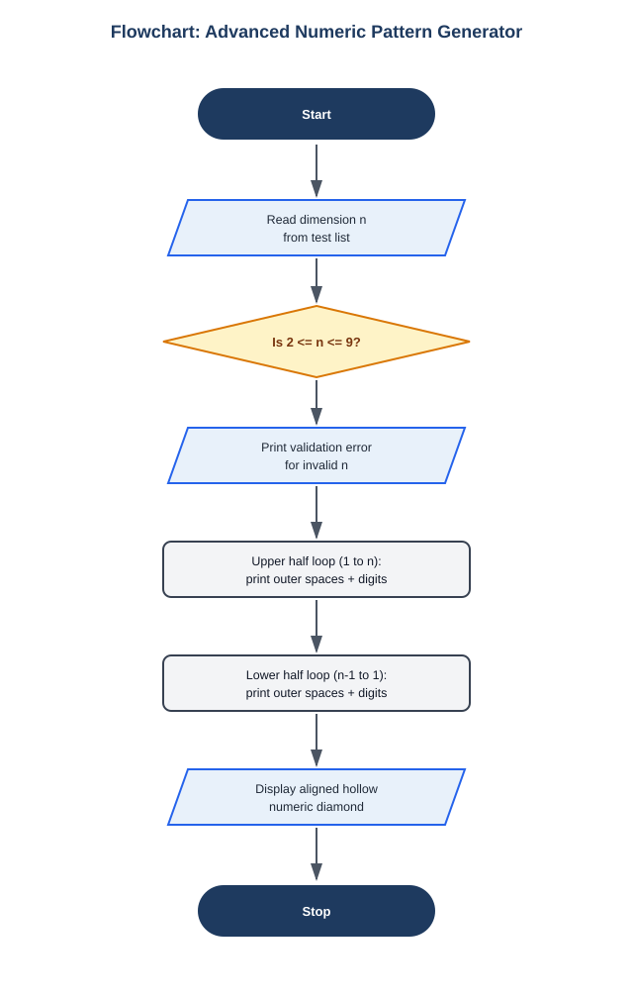
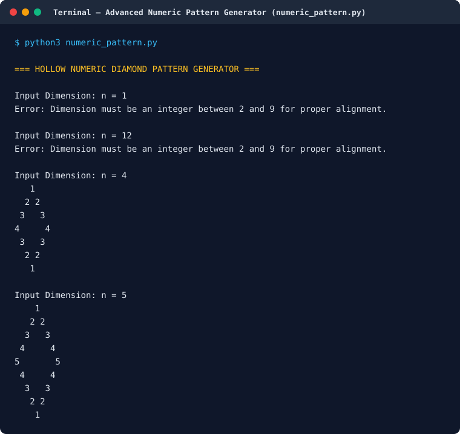

# Case Study 27 — Advanced Numeric Pattern Generator

> **Syllabus used:** variables · operators · conditional statements · loops · strings · pattern generation · lists

## Deliverables Index

| # | Deliverable | Where to find it |
| :---: | :--- | :--- |
| 1 | Problem statement | [Section 1](#1-problem-statement) |
| 2 | Objectives | [Section 2](#2-objectives) |
| 3 | Assumptions | [Section 3](#3-assumptions) |
| 4 | Algorithm | [Section 4](#4-algorithm) |
| 5 | Flowchart | [Section 5](#5-flowchart) · [`flowchart.svg`](flowchart.svg) |
| 6 | Pseudocode | [Section 6](#6-pseudocode) |
| 7 | Python source code | [Section 7](#7-python-source-code) · [`numeric_pattern.py`](numeric_pattern.py) |
| 8 | Test cases | [Section 8](#8-test-cases) |
| 9 | Output screenshots | [Section 9](#9-output-screenshots) · [`outputs/output_screenshot.svg`](outputs/output_screenshot.svg) |
| 10 | Conclusion | [Section 10](#10-conclusion) |

---

## 1. Problem Statement
Generate a symmetric hollow numeric diamond pattern based on user-specified dimensions, validating that the dimension is within an acceptable range and ensuring properly aligned output.

## 2. Objectives
- Validate input dimensions before generating the pattern.
- Use nested for loops to control leading spaces, digits, and hollow inner gaps.
- Demonstrate both valid pattern outputs and invalid dimension error handling.

## 3. Assumptions
- Valid dimension n is an integer between 2 and 9 (inclusive) so single-digit alignment remains exact.
- Row i (1 to n) prints number i at the left and right edges of the diamond, with spaces inside.

## 4. Algorithm
1. Start and define a list of test dimensions (including invalid values 1 and 12, and valid values 4 and 5).
2. For each dimension n, check if 2 <= n <= 9.
3. If invalid, print an error message and continue to the next test case.
4. For the upper half (row i from 1 to n): print (n - i) leading spaces, then i; if i > 1, print (2*i - 3) inner spaces and i.
5. For the lower half (row i from n - 1 down to 1): print (n - i) leading spaces, then i; if i > 1, print (2*i - 3) inner spaces and i.
6. Stop after all test dimensions are processed.

## 5. Flowchart


## 6. Pseudocode
```text
BEGIN
  SET test_sizes = [1, 12, 4, 5]
  FOR EACH n IN test_sizes:
    IF n < 2 OR n > 9: PRINT "Invalid dimension"; CONTINUE
    FOR i FROM 1 TO n: PRINT upper diamond row i
    FOR i FROM n - 1 DOWN TO 1: PRINT lower diamond row i
  END FOR
END
```

## 7. Python Source Code
File: [`numeric_pattern.py`](numeric_pattern.py)

```python
# Case Study 27: Advanced Numeric Pattern Generator
# Syllabus: Conditionals, Nested Loops, Pattern Generation, Strings, Lists

test_dimensions = [1, 12, 4, 5]

print("=== HOLLOW NUMERIC DIAMOND PATTERN GENERATOR ===")

for n in test_dimensions:
    print(f"\nInput Dimension: n = {n}")
    if n < 2 or n > 9:
        print("Error: Dimension must be an integer between 2 and 9 for proper alignment.")
        continue

    for i in range(1, n + 1):
        line = ""
        for s in range(n - i):
            line += " "
        line += str(i)
        if i > 1:
            for gap in range(2 * i - 3):
                line += " "
            line += str(i)
        print(line)

    for i in range(n - 1, 0, -1):
        line = ""
        for s in range(n - i):
            line += " "
        line += str(i)
        if i > 1:
            for gap in range(2 * i - 3):
                line += " "
            line += str(i)
        print(line)
```

## 8. Test Cases
| Test ID | Input Scenario | Expected Outcome | Status |
| :--- | :--- | :--- | :--- |
| TC-01 | n = 1 (Below minimum) | Validation error printed, skipped safely | Pass |
| TC-02 | n = 12 (Above maximum) | Validation error printed, skipped safely | Pass |
| TC-03 | n = 4 (Valid) | 7-row symmetric hollow diamond with digits 1-4 | Pass |
| TC-04 | n = 5 (Valid) | 9-row symmetric hollow diamond with digits 1-5 | Pass |

## 9. Output Screenshots


## 10. Conclusion
Nested loops allow precise row-by-row spacing and symmetry for hollow numeric patterns, while upfront dimension validation prevents malformed or misaligned console output.
