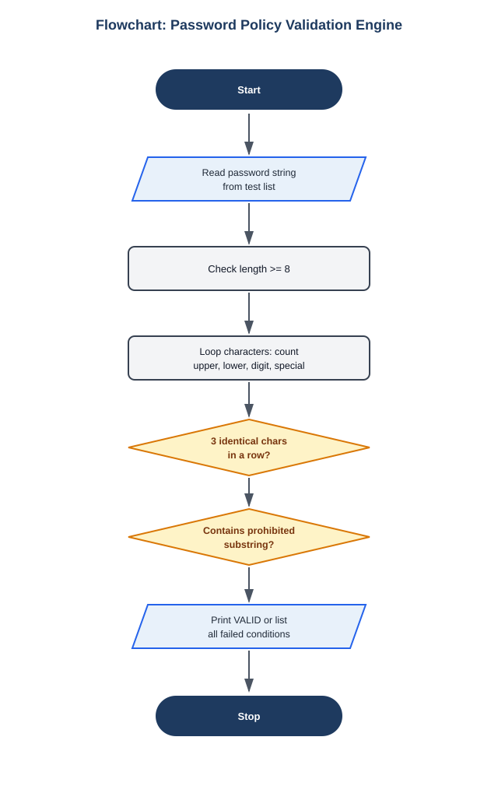
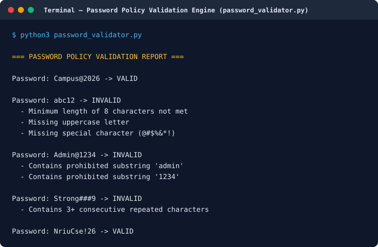

# Case Study 29 — Password Policy Validation Engine

> **Syllabus used:** variables · conditional statements · loops · strings · lists

## Deliverables Index

| # | Deliverable | Where to find it |
| :---: | :--- | :--- |
| 1 | Problem statement | [Section 1](#1-problem-statement) |
| 2 | Objectives | [Section 2](#2-objectives) |
| 3 | Assumptions | [Section 3](#3-assumptions) |
| 4 | Algorithm | [Section 4](#4-algorithm) |
| 5 | Flowchart | [Section 5](#5-flowchart) · [`flowchart.svg`](flowchart.svg) |
| 6 | Pseudocode | [Section 6](#6-pseudocode) |
| 7 | Python source code | [Section 7](#7-python-source-code) · [`password_validator.py`](password_validator.py) |
| 8 | Test cases | [Section 8](#8-test-cases) |
| 9 | Output screenshots | [Section 9](#9-output-screenshots) · [`outputs/output_screenshot.svg`](outputs/output_screenshot.svg) |
| 10 | Conclusion | [Section 10](#10-conclusion) |

---

## 1. Problem Statement
Evaluate candidate password strings against security rules: minimum length, character categories (uppercase, lowercase, digit, special character), consecutive character repetition, and prohibited substrings, reporting every failed rule.

## 2. Objectives
- Inspect each character of a string using loops and string methods.
- Detect consecutive repeated characters (3 or more identical characters in a row).
- Check for prohibited weak substrings and list all failed conditions clearly.

## 3. Assumptions
- Minimum password length is 8 characters.
- Must contain at least 1 uppercase, 1 lowercase, 1 digit, and 1 special character from '@#$%&*!'.
- No character may repeat 3 times consecutively (e.g., 'aaa').
- Prohibited substrings (case-insensitive): 'password', 'admin', '1234', 'qwerty'.

## 4. Algorithm
1. Start with a list of sample passwords and a list of prohibited substrings.
2. For each password, initialize boolean flags for uppercase, lowercase, digit, special char, and repetition.
3. Check length >= 8; if not, append failure reason.
4. Loop through characters to set category flags and check if ch == prev == next for 3-in-a-row repetition.
5. Convert password to lowercase and check if any prohibited substring is present.
6. If the failures list is empty, mark VALID; otherwise mark INVALID and print all failed rules.

## 5. Flowchart


## 6. Pseudocode
```text
BEGIN
  SET passwords = ["Campus@2026", "abc12", "Admin@1234", "Strong###9", "NriuCse!26"]
  FOR EACH pwd IN passwords:
    SET failures = []
    IF len(pwd) < 8: APPEND "Length < 8"
    SCAN characters for upper, lower, digit, special, and 3-char repeat
    CHECK prohibited substrings in pwd.lower()
    PRINT pwd status and failures
  END FOR
END
```

## 7. Python Source Code
File: [`password_validator.py`](password_validator.py)

```python
# Case Study 29: Password Policy Validation Engine
# Syllabus: Strings, Loops, Conditionals, Lists

sample_passwords = [
    "Campus@2026",
    "abc12",
    "Admin@1234",
    "Strong###9",
    "NriuCse!26"
]

special_chars = "@#$%&*!"
prohibited = ["password", "admin", "1234", "qwerty"]

print("=== PASSWORD POLICY VALIDATION REPORT ===")

for pwd in sample_passwords:
    failures = []

    if len(pwd) < 8:
        failures.append("Minimum length of 8 characters not met")

    has_upper = False
    has_lower = False
    has_digit = False
    has_special = False
    has_repeat = False

    for i in range(len(pwd)):
        ch = pwd[i]
        if ch.isupper():
            has_upper = True
        elif ch.islower():
            has_lower = True
        elif ch.isdigit():
            has_digit = True
        elif ch in special_chars:
            has_special = True

        if i >= 2 and pwd[i] == pwd[i - 1] and pwd[i] == pwd[i - 2]:
            has_repeat = True

    if not has_upper:
        failures.append("Missing uppercase letter")
    if not has_lower:
        failures.append("Missing lowercase letter")
    if not has_digit:
        failures.append("Missing numeric digit")
    if not has_special:
        failures.append("Missing special character (@#$%&*!)")
    if has_repeat:
        failures.append("Contains 3+ consecutive repeated characters")

    low_pwd = pwd.lower()
    for bad in prohibited:
        if bad in low_pwd:
            failures.append(f"Contains prohibited substring '{bad}'")

    if len(failures) == 0:
        print(f"\nPassword: {pwd} -> VALID")
    else:
        print(f"\nPassword: {pwd} -> INVALID")
        for reason in failures:
            print(f"  - {reason}")
```

## 8. Test Cases
| Test ID | Input Scenario | Expected Outcome | Status |
| :--- | :--- | :--- | :--- |
| TC-01 | Campus@2026 | VALID (all rules satisfied) | Pass |
| TC-02 | abc12 | INVALID (length < 8, no upper, no special) | Pass |
| TC-03 | Admin@1234 | INVALID (prohibited 'admin' and '1234') | Pass |
| TC-04 | Strong###9 | INVALID (3 consecutive '#' characters) | Pass |

## 9. Output Screenshots


## 10. Conclusion
Character-level string iteration combined with list-based rule tracking provides clear, actionable diagnostics for every password policy violation.
