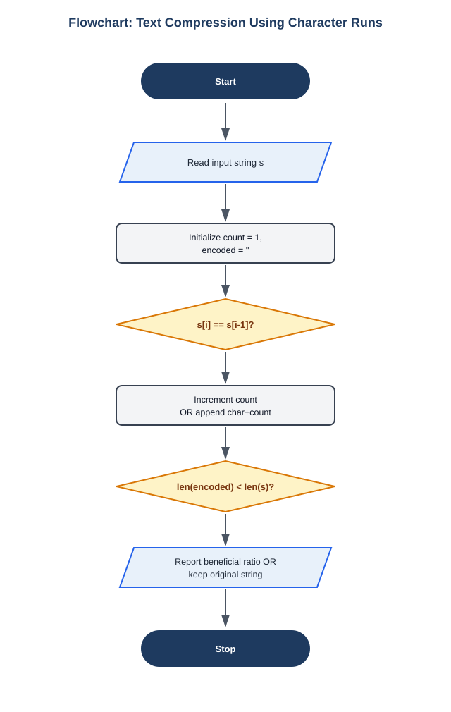
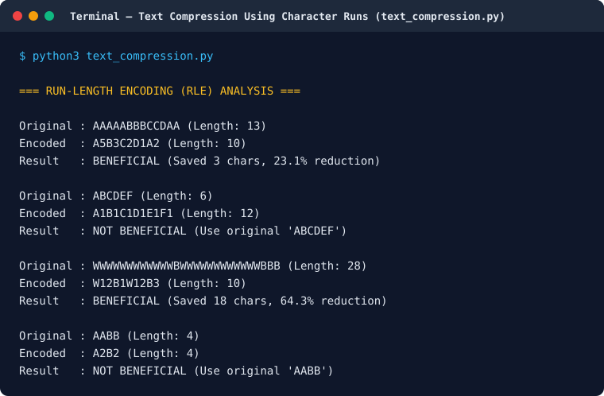

# Case Study 35 — Text Compression Using Character Runs

> **Syllabus used:** variables · operators · conditional statements · loops · strings · lists

## Deliverables Index

| # | Deliverable | Where to find it |
| :---: | :--- | :--- |
| 1 | Problem statement | [Section 1](#1-problem-statement) |
| 2 | Objectives | [Section 2](#2-objectives) |
| 3 | Assumptions | [Section 3](#3-assumptions) |
| 4 | Algorithm | [Section 4](#4-algorithm) |
| 5 | Flowchart | [Section 5](#5-flowchart) · [`flowchart.svg`](flowchart.svg) |
| 6 | Pseudocode | [Section 6](#6-pseudocode) |
| 7 | Python source code | [Section 7](#7-python-source-code) · [`text_compression.py`](text_compression.py) |
| 8 | Test cases | [Section 8](#8-test-cases) |
| 9 | Output screenshots | [Section 9](#9-output-screenshots) · [`outputs/output_screenshot.svg`](outputs/output_screenshot.svg) |
| 10 | Conclusion | [Section 10](#10-conclusion) |

---

## 1. Problem Statement
Compress strings using Run-Length Encoding (RLE) by grouping consecutive repeated characters. Compare original and encoded lengths, and report when encoding is not beneficial (i.e., when the encoded string is not shorter than the original).

## 2. Objectives
- Group consecutive identical characters using string indexing and a loop.
- Calculate compression ratio and space saved in characters.
- Identify cases where RLE increases or matches original length and retain the original string.

## 3. Assumptions
- Input strings contain alphabetic characters without embedded digits.
- Each run is encoded as <char><count> (e.g., 'AAAABBB' -> 'A4B3').
- Encoding is beneficial only if len(encoded) < len(original).

## 4. Algorithm
1. Start with a list of test strings.
2. For each string s, if s is empty, skip.
3. Initialize encoded = '', count = 1.
4. Loop index i from 1 to len(s) - 1: if s[i] == s[i - 1], increment count; else append s[i - 1] + str(count) to encoded and reset count = 1.
5. After the loop, append the final run s[-1] + str(count) to encoded.
6. Compare len(encoded) with len(s); compute savings percentage and report whether compression is beneficial.

## 5. Flowchart


## 6. Pseudocode
```text
BEGIN
  SET inputs = ["AAAAABBBCCDAA", "ABCDEF", "WWWWWWWWWWWWBWWWWWWWWWWWWBBB", "AABB"]
  FOR EACH s IN inputs:
    SET encoded = "", count = 1
    FOR i FROM 1 TO len(s) - 1:
      IF s[i] == s[i - 1]: count += 1
      ELSE: encoded += s[i - 1] + str(count); count = 1
    END FOR
    encoded += s[-1] + str(count)
    IF len(encoded) < len(s): PRINT "Beneficial"
    ELSE: PRINT "Not beneficial, keep original"
  END FOR
END
```

## 7. Python Source Code
File: [`text_compression.py`](text_compression.py)

```python
# Case Study 35: Text Compression Using Character Runs (RLE)
# Syllabus: Strings, Loops, Conditionals, Operators, Lists

test_strings = [
    "AAAAABBBCCDAA",
    "ABCDEF",
    "WWWWWWWWWWWWBWWWWWWWWWWWWBBB",
    "AABB"
]

print("=== RUN-LENGTH ENCODING (RLE) ANALYSIS ===")

for text in test_strings:
    if len(text) == 0:
        print("Empty string -> Skipped")
        continue

    encoded = ""
    count = 1

    for i in range(1, len(text)):
        if text[i] == text[i - 1]:
            count += 1
        else:
            encoded += text[i - 1] + str(count)
            count = 1

    encoded += text[-1] + str(count)

    orig_len = len(text)
    enc_len = len(encoded)

    print(f"\nOriginal : {text} (Length: {orig_len})")
    print(f"Encoded  : {encoded} (Length: {enc_len})")

    if enc_len < orig_len:
        saved_pct = ((orig_len - enc_len) / orig_len) * 100.0
        print(f"Result   : BENEFICIAL (Saved {orig_len - enc_len} chars, {saved_pct:.1f}% reduction)")
    else:
        print(f"Result   : NOT BENEFICIAL (Use original '{text}')")
```

## 8. Test Cases
| Test ID | Input Scenario | Expected Outcome | Status |
| :--- | :--- | :--- | :--- |
| TC-01 | AAAAABBBCCDAA (len 13) | Encoded 'A5B3C2D1A2' (len 10) -> Beneficial (23.1%) | Pass |
| TC-02 | ABCDEF (len 6) | Encoded 'A1B1C1D1E1F1' (len 12) -> Not beneficial | Pass |
| TC-03 | WWWWWWWWWWWWBWWWWWWWWWWWWBBB (len 28) | Encoded 'W12B1W12B3' (len 10) -> Beneficial (64.3%) | Pass |
| TC-04 | AABB (len 4) | Encoded 'A2B2' (len 4) -> Not beneficial (equal length) | Pass |

## 9. Output Screenshots


## 10. Conclusion
Run-Length Encoding achieves high compression on strings with long consecutive character runs, while length comparison cleanly prevents expansion on non-repetitive text.
