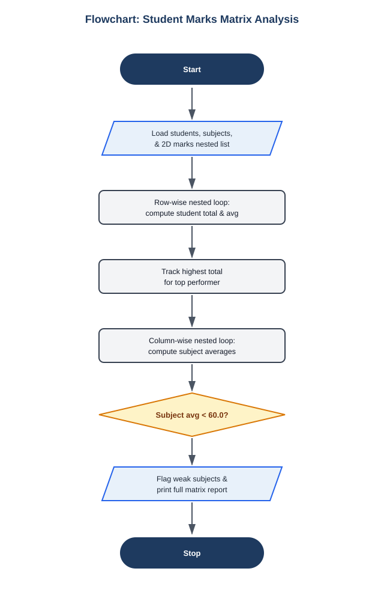
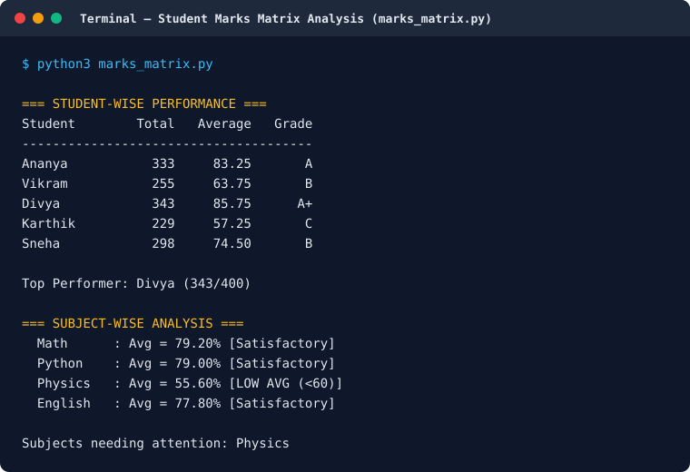

# Case Study 42 — Student Marks Matrix Analysis

> **Syllabus used:** variables · operators · conditional statements · loops · lists · nested lists

## Deliverables Index

| # | Deliverable | Where to find it |
| :---: | :--- | :--- |
| 1 | Problem statement | [Section 1](#1-problem-statement) |
| 2 | Objectives | [Section 2](#2-objectives) |
| 3 | Assumptions | [Section 3](#3-assumptions) |
| 4 | Algorithm | [Section 4](#4-algorithm) |
| 5 | Flowchart | [Section 5](#5-flowchart) · [`flowchart.svg`](flowchart.svg) |
| 6 | Pseudocode | [Section 6](#6-pseudocode) |
| 7 | Python source code | [Section 7](#7-python-source-code) · [`marks_matrix.py`](marks_matrix.py) |
| 8 | Test cases | [Section 8](#8-test-cases) |
| 9 | Output screenshots | [Section 9](#9-output-screenshots) · [`outputs/output_screenshot.svg`](outputs/output_screenshot.svg) |
| 10 | Conclusion | [Section 10](#10-conclusion) |

---

## 1. Problem Statement
Analyze a 2D matrix of student marks across multiple subjects stored as nested lists. Compute row-wise (student) totals and averages, column-wise (subject) averages, identify top performers, and flag subjects with low average performance.

## 2. Objectives
- Represent multi-student, multi-subject marks using nested lists.
- Traverse rows and columns using nested loops to calculate statistics.
- Identify the top-scoring student and subjects averaging below 60%.

## 3. Assumptions
- Each mark is out of 100 across 4 subjects: Math, Python, Physics, English.
- A subject with class average < 60.0 is flagged as needing academic attention.

## 4. Algorithm
1. Start with a list of student names, a list of subject names, and a 2D nested list of marks.
2. Loop through each student row to compute row total, row average, and track the maximum total.
3. Loop through each subject column to sum marks across all students and compute subject average.
4. Flag any subject whose average is below 60.0.
5. Display student totals/averages, top performer, and subject-wise report, then stop.

## 5. Flowchart


## 6. Pseudocode
```text
BEGIN
  SET students, subjects, marks_matrix
  FOR i FROM 0 TO len(students) - 1:
    COMPUTE row_sum, row_avg; UPDATE top_student
  END FOR
  FOR col FROM 0 TO len(subjects) - 1:
    COMPUTE col_sum across all rows; col_avg = col_sum / len(students)
    IF col_avg < 60: FLAG weak subject
  END FOR
  PRINT matrix analysis report
END
```

## 7. Python Source Code
File: [`marks_matrix.py`](marks_matrix.py)

```python
# Case Study 42: Student Marks Matrix Analysis
# Syllabus: Nested Lists, Loops, Conditionals, Operators

students = ["Ananya", "Vikram", "Divya", "Karthik", "Sneha"]
subjects = ["Math", "Python", "Physics", "English"]

marks_matrix = [
    [88, 92, 68, 85],
    [72, 65, 48, 70],
    [95, 96, 62, 90],
    [60, 58, 45, 66],
    [81, 84, 55, 78]
]

top_student = ""
top_total = -1

print("=== STUDENT-WISE PERFORMANCE ===")
print(f"{'Student':<12}{'Total':>8}{'Average':>10}{'Grade':>8}")
print("-" * 38)

for i in range(len(marks_matrix)):
    row = marks_matrix[i]
    row_total = 0
    for score in row:
        row_total += score
    row_avg = row_total / len(row)

    if row_avg >= 85:
        grade = "A+"
    elif row_avg >= 75:
        grade = "A"
    elif row_avg >= 60:
        grade = "B"
    else:
        grade = "C"

    if row_total > top_total:
        top_total = row_total
        top_student = students[i]

    print(f"{students[i]:<12}{row_total:>8}{row_avg:>10.2f}{grade:>8}")

print(f"\nTop Performer: {top_student} ({top_total}/400)")

print("\n=== SUBJECT-WISE ANALYSIS ===")
weak_subjects = []
num_students = len(marks_matrix)

for col in range(len(subjects)):
    col_total = 0
    for row_idx in range(num_students):
        col_total += marks_matrix[row_idx][col]
    col_avg = col_total / num_students
    status = "LOW AVG (<60)" if col_avg < 60.0 else "Satisfactory"
    if col_avg < 60.0:
        weak_subjects.append(subjects[col])
    print(f"  {subjects[col]:<10}: Avg = {col_avg:.2f}% [{status}]")

if len(weak_subjects) > 0:
    print(f"\nSubjects needing attention: {', '.join(weak_subjects)}")
```

## 8. Test Cases
| Test ID | Input Scenario | Expected Outcome | Status |
| :--- | :--- | :--- | :--- |
| TC-01 | Divya [95, 96, 62, 90] | Total=343, Avg=85.75, Grade=A+, Top Performer | Pass |
| TC-02 | Karthik [60, 58, 45, 66] | Total=229, Avg=57.25, Grade=C | Pass |
| TC-03 | Physics column [68, 48, 62, 45, 55] | Avg=55.60% -> Flagged as LOW AVG (<60) | Pass |
| TC-04 | Python column [92, 65, 96, 58, 84] | Avg=79.00% -> Satisfactory | Pass |

## 9. Output Screenshots


## 10. Conclusion
Nested lists and dual-axis loops provide an intuitive way to compute both student-level and subject-level analytics without requiring external libraries.
