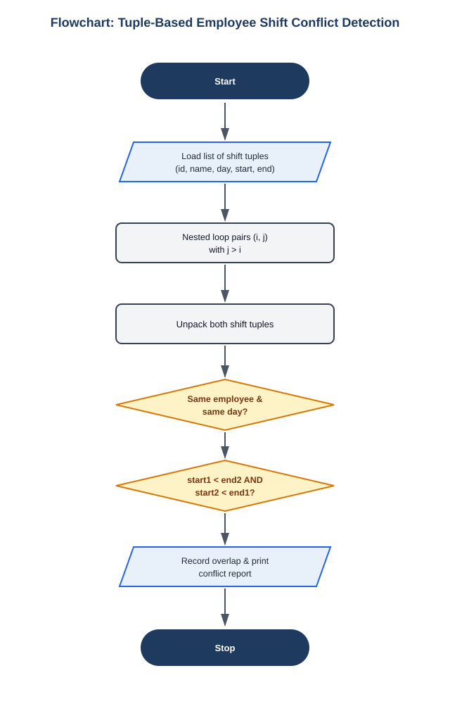
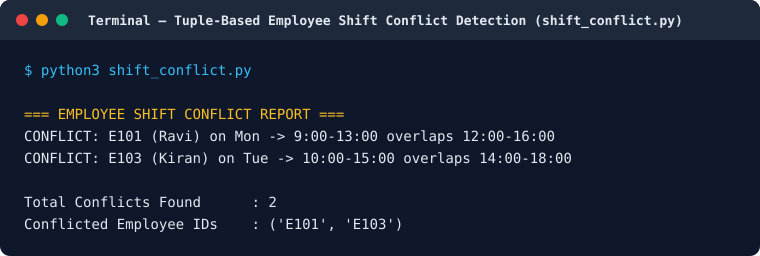

# Case Study 48 — Tuple-Based Employee Shift Conflict Detection

> **Syllabus used:** conditional statements · loops · lists · tuples · tuple operations · unpacking

## Deliverables Index

| # | Deliverable | Where to find it |
| :---: | :--- | :--- |
| 1 | Problem statement | [Section 1](#1-problem-statement) |
| 2 | Objectives | [Section 2](#2-objectives) |
| 3 | Assumptions | [Section 3](#3-assumptions) |
| 4 | Algorithm | [Section 4](#4-algorithm) |
| 5 | Flowchart | [Section 5](#5-flowchart) · [`flowchart.svg`](flowchart.svg) |
| 6 | Pseudocode | [Section 6](#6-pseudocode) |
| 7 | Python source code | [Section 7](#7-python-source-code) · [`shift_conflict.py`](shift_conflict.py) |
| 8 | Test cases | [Section 8](#8-test-cases) |
| 9 | Output screenshots | [Section 9](#9-output-screenshots) · [`outputs/output_screenshot.svg`](outputs/output_screenshot.svg) |
| 10 | Conclusion | [Section 10](#10-conclusion) |

---

## 1. Problem Statement
Represent employee work shifts as tuples containing employee ID, day, start hour, and end hour. Compare shift intervals for the same employee on the same day to detect overlapping assignments and list all employees with conflicting schedules.

## 2. Objectives
- Model shift assignments cleanly using immutable tuples.
- Unpack shift tuples and apply interval-overlap logic (start1 < end2 and start2 < end1).
- Identify and report all conflicting shift pairs and affected employees.

## 3. Assumptions
- Time is represented in 24-hour integer format (0 to 24); end_hour > start_hour.
- Two shifts touching at an endpoint (e.g., 9-13 and 13-17) are back-to-back, not overlapping.

## 4. Algorithm
1. Start with a list of shift tuples: (emp_id, emp_name, day, start_hr, end_hr).
2. Initialize an empty list for conflicts and an empty list for conflicted employee IDs.
3. Use nested loops (i from 0 to n-1, j from i+1 to n-1) to compare every pair of shifts.
4. Unpack both shift tuples.
5. If emp_id1 == emp_id2 and day1 == day2, check if start1 < end2 and start2 < end1.
6. If overlapping, record the conflict pair and add emp_id to conflicted_ids if not already present.
7. Print all detected conflicts and the tuple of affected employees, then stop.

## 5. Flowchart


## 6. Pseudocode
```text
BEGIN
  SET shifts = [("E101", "Ravi", "Mon", 9, 13), ("E101", "Ravi", "Mon", 12, 16), ...]
  FOR i FROM 0 TO len(shifts) - 1:
    FOR j FROM i + 1 TO len(shifts) - 1:
      UNPACK (id1, name1, day1, s1, e1) = shifts[i]
      UNPACK (id2, name2, day2, s2, e2) = shifts[j]
      IF id1 == id2 AND day1 == day2 AND s1 < e2 AND s2 < e1:
        APPEND conflict pair TO conflicts
      END IF
    END FOR
  END FOR
  PRINT conflicts and affected employees
END
```

## 7. Python Source Code
File: [`shift_conflict.py`](shift_conflict.py)

```python
# Case Study 48: Tuple-Based Employee Shift Conflict Detection
# Syllabus: Tuples, Tuple Operations, Unpacking, Nested Loops, Conditionals

shifts = [
    ("E101", "Ravi", "Mon", 9, 13),
    ("E101", "Ravi", "Mon", 12, 16),
    ("E102", "Priya", "Mon", 9, 13),
    ("E102", "Priya", "Mon", 13, 17),
    ("E103", "Kiran", "Tue", 10, 15),
    ("E103", "Kiran", "Tue", 14, 18),
    ("E101", "Ravi", "Wed", 9, 17)
]

conflicts = []
conflicted_ids = []

for i in range(len(shifts)):
    id1, name1, day1, s1, e1 = shifts[i]
    for j in range(i + 1, len(shifts)):
        id2, name2, day2, s2, e2 = shifts[j]

        if id1 == id2 and day1 == day2:
            if s1 < e2 and s2 < e1:
                conflicts.append((id1, name1, day1, (s1, e1), (s2, e2)))
                if id1 not in conflicted_ids:
                    conflicted_ids.append(id1)

print("=== EMPLOYEE SHIFT CONFLICT REPORT ===")
if len(conflicts) == 0:
    print("No shift conflicts detected.")
else:
    for emp_id, name, day, slot1, slot2 in conflicts:
        print(f"CONFLICT: {emp_id} ({name}) on {day} -> {slot1[0]}:00-{slot1[1]}:00 overlaps {slot2[0]}:00-{slot2[1]}:00")

    print(f"\nTotal Conflicts Found      : {len(conflicts)}")
    print(f"Conflicted Employee IDs    : {tuple(conflicted_ids)}")
```

## 8. Test Cases
| Test ID | Input Scenario | Expected Outcome | Status |
| :--- | :--- | :--- | :--- |
| TC-01 | E101 Mon (9-13) & (12-16) | Overlap detected (12 < 13 and 9 < 16) | Pass |
| TC-02 | E102 Mon (9-13) & (13-17) | No conflict (touching endpoints allowed) | Pass |
| TC-03 | E103 Tue (10-15) & (14-18) | Overlap detected | Pass |
| TC-04 | E101 Wed (9-17) | Different day -> no conflict with Mon | Pass |

## 9. Output Screenshots


## 10. Conclusion
Tuples and tuple unpacking make interval-based schedule comparison concise and readable, accurately distinguishing true overlaps from valid back-to-back shifts.
