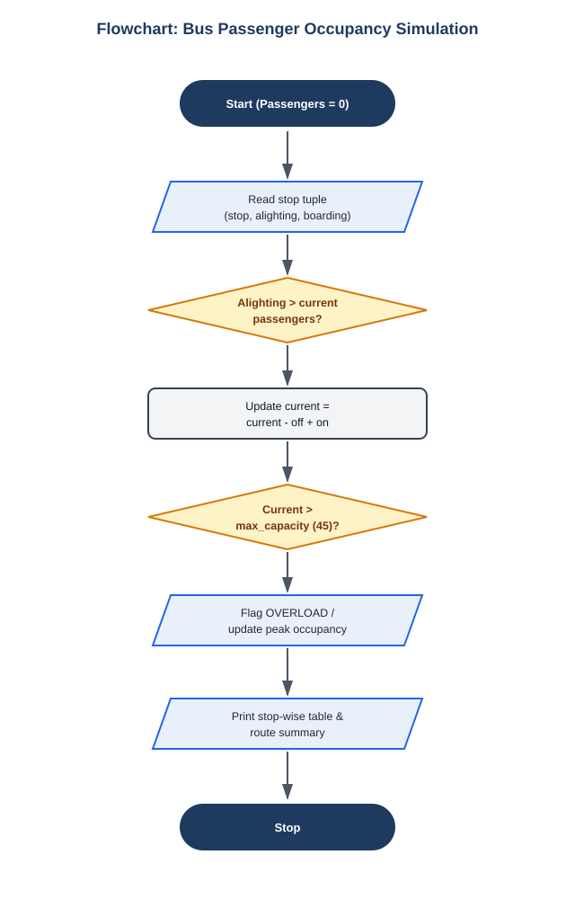
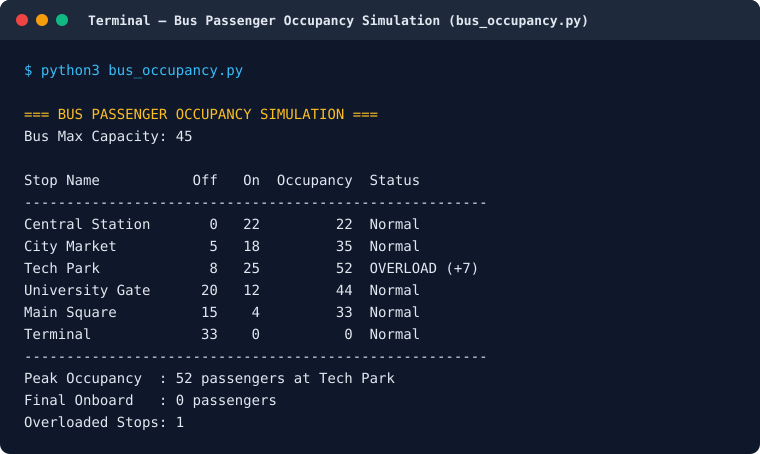

# Case Study 51 — Bus Passenger Occupancy Simulation

> **Syllabus used:** variables · operators · conditional statements · loops · lists · tuples · unpacking

## Deliverables Index

| # | Deliverable | Where to find it |
| :---: | :--- | :--- |
| 1 | Problem statement | [Section 1](#1-problem-statement) |
| 2 | Objectives | [Section 2](#2-objectives) |
| 3 | Assumptions | [Section 3](#3-assumptions) |
| 4 | Algorithm | [Section 4](#4-algorithm) |
| 5 | Flowchart | [Section 5](#5-flowchart) · [`flowchart.svg`](flowchart.svg) |
| 6 | Pseudocode | [Section 6](#6-pseudocode) |
| 7 | Python source code | [Section 7](#7-python-source-code) · [`bus_occupancy.py`](bus_occupancy.py) |
| 8 | Test cases | [Section 8](#8-test-cases) |
| 9 | Output screenshots | [Section 9](#9-output-screenshots) · [`outputs/output_screenshot.svg`](outputs/output_screenshot.svg) |
| 10 | Conclusion | [Section 10](#10-conclusion) |

---

## 1. Problem Statement
Simulate bus passenger occupancy across multiple sequential stops using boarding and alighting counts. Track the passenger count after each stop, detect invalid alighting counts, and flag any capacity violations.

## 2. Objectives
- Model stop-by-stop boarding and alighting data as a list of tuples.
- Update running passenger count and track peak occupancy across the route.
- Flag capacity violations whenever occupancy exceeds the bus capacity limit.

## 3. Assumptions
- Bus starts empty (0 passengers) with maximum capacity of 45 passengers.
- At each stop, alighting happens before boarding; alighting > current passengers is flagged as a warning.

## 4. Algorithm
1. Start with max_capacity = 45, current_passengers = 0, peak_occupancy = 0.
2. Define route stops as a list of tuples (stop_name, alighting, boarding).
3. For each (stop, off, on) in stops: check if off > current_passengers; if so, clamp to current_passengers.
4. Update current_passengers = current_passengers - off + on.
5. If current_passengers > peak_occupancy, update peak_occupancy.
6. If current_passengers > max_capacity, flag a capacity violation.
7. Print stop-wise occupancy table, peak load, and violated stops, then stop.

## 5. Flowchart


## 6. Pseudocode
```text
BEGIN
  SET max_cap = 45, current = 0, peak = 0
  FOR EACH (stop, off, on) IN route_stops:
    IF off > current: LOG warning; off = current
    current = current - off + on
    IF current > peak: peak = current
    IF current > max_cap: FLAG "OVERLOAD"
    PRINT stop details
  END FOR
  PRINT peak occupancy and violations
END
```

## 7. Python Source Code
File: [`bus_occupancy.py`](bus_occupancy.py)

```python
# Case Study 51: Bus Passenger Occupancy Simulation
# Syllabus: Lists, Tuples, Unpacking, Loops, Conditionals

max_capacity = 45
current_passengers = 0
peak_occupancy = 0
peak_stop = ""
overloaded_stops = []

route_stops = [
    ("Central Station", 0, 22),
    ("City Market", 5, 18),
    ("Tech Park", 8, 25),
    ("University Gate", 20, 12),
    ("Main Square", 15, 4),
    ("Terminal", 33, 0)
]

print("=== BUS PASSENGER OCCUPANCY SIMULATION ===")
print(f"Bus Max Capacity: {max_capacity}\n")
print(f"{'Stop Name':<18}{'Off':>5}{'On':>5}{'Occupancy':>11}  {'Status'}")
print("-" * 55)

for stop_name, alighting, boarding in route_stops:
    if alighting > current_passengers:
        print(f"  [Warning] {stop_name}: Alighting ({alighting}) > Onboard ({current_passengers}). Adjusted.")
        alighting = current_passengers

    current_passengers = current_passengers - alighting + boarding

    if current_passengers > peak_occupancy:
        peak_occupancy = current_passengers
        peak_stop = stop_name

    if current_passengers > max_capacity:
        excess = current_passengers - max_capacity
        status = f"OVERLOAD (+{excess})"
        overloaded_stops.append((stop_name, current_passengers, excess))
    else:
        status = "Normal"

    print(f"{stop_name:<18}{alighting:>5}{boarding:>5}{current_passengers:>11}  {status}")

print("-" * 55)
print(f"Peak Occupancy  : {peak_occupancy} passengers at {peak_stop}")
print(f"Final Onboard   : {current_passengers} passengers")
print(f"Overloaded Stops: {len(overloaded_stops)}")
```

## 8. Test Cases
| Test ID | Input Scenario | Expected Outcome | Status |
| :--- | :--- | :--- | :--- |
| TC-01 | Central Station (0 off, 22 on) | Occupancy = 22, Status = Normal | Pass |
| TC-02 | Tech Park (8 off, 25 on from 35) | Occupancy = 52 -> Flagged OVERLOAD (+7) | Pass |
| TC-03 | University Gate (20 off, 12 on) | Occupancy drops to 44 -> Normal | Pass |
| TC-04 | Terminal (33 off, 0 on) | Occupancy = 0 (all passengers alighted) | Pass |

## 9. Output Screenshots


## 10. Conclusion
Sequential tuple unpacking cleanly models real-time transit occupancy, immediately identifying overloaded route segments and peak demand stops.
