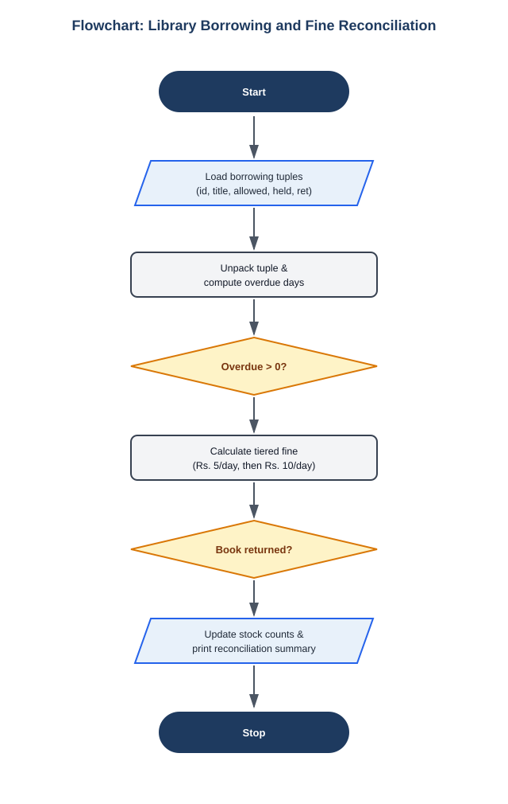
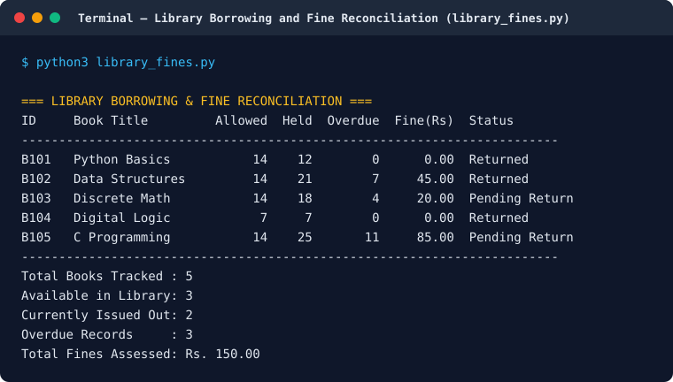

# Case Study 58 — Library Borrowing and Fine Reconciliation

> **Syllabus used:** variables · operators · conditional statements · loops · lists · tuples · unpacking

## Deliverables Index

| # | Deliverable | Where to find it |
| :---: | :--- | :--- |
| 1 | Problem statement | [Section 1](#1-problem-statement) |
| 2 | Objectives | [Section 2](#2-objectives) |
| 3 | Assumptions | [Section 3](#3-assumptions) |
| 4 | Algorithm | [Section 4](#4-algorithm) |
| 5 | Flowchart | [Section 5](#5-flowchart) · [`flowchart.svg`](flowchart.svg) |
| 6 | Pseudocode | [Section 6](#6-pseudocode) |
| 7 | Python source code | [Section 7](#7-python-source-code) · [`library_fines.py`](library_fines.py) |
| 8 | Test cases | [Section 8](#8-test-cases) |
| 9 | Output screenshots | [Section 9](#9-output-screenshots) · [`outputs/output_screenshot.svg`](outputs/output_screenshot.svg) |
| 10 | Conclusion | [Section 10](#10-conclusion) |

---

## 1. Problem Statement
Analyze library borrowing records stored as tuples containing book ID, title, allowed borrowing days, actual days held, and return status. Calculate overdue days and fines, flag overdue records, and reconcile remaining book availability.

## 2. Objectives
- Process borrowing tuples using tuple unpacking and conditional fine slabs.
- Identify overdue and unreturned books separately.
- Reconcile total books issued, returned, still out, and total fines collected.

## 3. Assumptions
- Total library stock for the tracked set is 5 books (1 copy each).
- Fine rate: Rs. 5/day for first 5 overdue days; Rs. 10/day for each overdue day beyond 5.
- Unreturned books accrue pending fines based on days held so far.

## 4. Algorithm
1. Start with a list of borrowing tuples (book_id, title, allowed_days, days_held, returned_bool).
2. Initialize counters for returned_count, unreturned_count, overdue_count, and total_fine.
3. Loop through each tuple and unpack all five fields.
4. Calculate overdue_days = days_held - allowed_days if days_held > allowed_days else 0.
5. If overdue_days > 0: increment overdue_count and compute fine (first 5 days @ Rs. 5 + remaining @ Rs. 10).
6. Update returned vs. unreturned counts and print the itemized reconciliation table.
7. Display final stock availability and total fines, then stop.

## 5. Flowchart


## 6. Pseudocode
```text
BEGIN
  FOR EACH (bid, title, allowed, held, returned) IN borrowing_records:
    overdue = held - allowed IF held > allowed ELSE 0
    IF overdue == 0: fine = 0
    ELSE IF overdue <= 5: fine = overdue * 5
    ELSE: fine = 5 * 5 + (overdue - 5) * 10
    UPDATE returned/unreturned counters and total_fine
    PRINT record status
  END FOR
  PRINT availability and fine summary
END
```

## 7. Python Source Code
File: [`library_fines.py`](library_fines.py)

```python
# Case Study 58: Library Borrowing and Fine Reconciliation
# Syllabus: Tuples, Unpacking, Lists, Loops, Conditionals

borrowing_records = [
    ("B101", "Python Basics", 14, 12, True),
    ("B102", "Data Structures", 14, 21, True),
    ("B103", "Discrete Math", 14, 18, False),
    ("B104", "Digital Logic", 7, 7, True),
    ("B105", "C Programming", 14, 25, False)
]

total_fines = 0.0
returned_books = 0
unreturned_books = 0
overdue_count = 0

print("=== LIBRARY BORROWING & FINE RECONCILIATION ===")
print(f"{'ID':<7}{'Book Title':<18}{'Allowed':>8}{'Held':>6}{'Overdue':>9}{'Fine(Rs)':>10}  {'Status'}")
print("-" * 72)

for book_id, title, allowed_days, days_held, is_returned in borrowing_records:
    overdue_days = days_held - allowed_days if days_held > allowed_days else 0

    if overdue_days == 0:
        fine = 0.0
    elif overdue_days <= 5:
        fine = overdue_days * 5.0
    else:
        fine = (5 * 5.0) + (overdue_days - 5) * 10.0

    if overdue_days > 0:
        overdue_count += 1

    total_fines += fine

    if is_returned:
        returned_books += 1
        status = "Returned"
    else:
        unreturned_books += 1
        status = "Pending Return"

    print(f"{book_id:<7}{title:<18}{allowed_days:>8}{days_held:>6}{overdue_days:>9}{fine:>10.2f}  {status}")

print("-" * 72)
print(f"Total Books Tracked : {len(borrowing_records)}")
print(f"Available in Library: {returned_books}")
print(f"Currently Issued Out: {unreturned_books}")
print(f"Overdue Records     : {overdue_count}")
print(f"Total Fines Assessed: Rs. {total_fines:.2f}")
```

## 8. Test Cases
| Test ID | Input Scenario | Expected Outcome | Status |
| :--- | :--- | :--- | :--- |
| TC-01 | B101 (Allowed 14, Held 12, Returned) | Overdue=0, Fine=Rs. 0.00, Available | Pass |
| TC-02 | B102 (Allowed 14, Held 21, Returned) | Overdue=7, Fine=Rs. 45.00 (5*5 + 2*10) | Pass |
| TC-03 | B103 (Allowed 14, Held 18, Not Returned) | Overdue=4, Fine=Rs. 20.00, Pending Return | Pass |
| TC-04 | B105 (Allowed 14, Held 25, Not Returned) | Overdue=11, Fine=Rs. 85.00, Pending Return | Pass |

## 9. Output Screenshots


## 10. Conclusion
The library reconciliation script automates overdue detection, progressive fine calculation, and inventory availability tracking using tuples and conditional logic.
